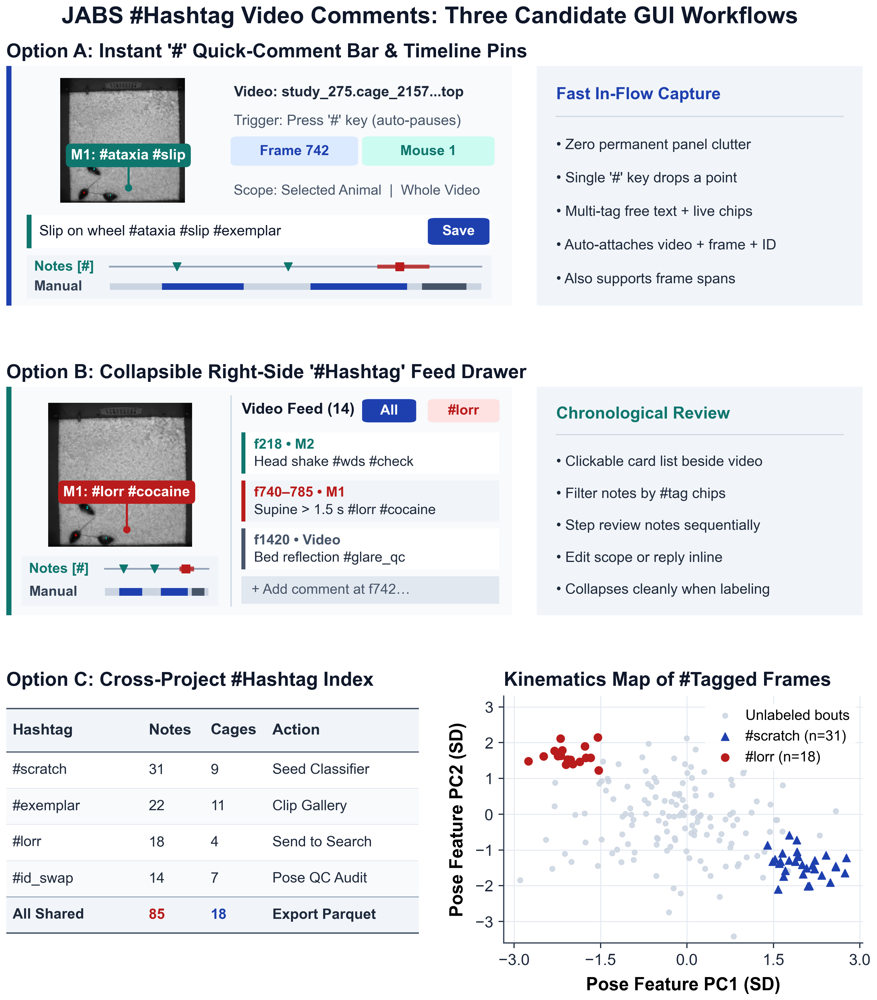
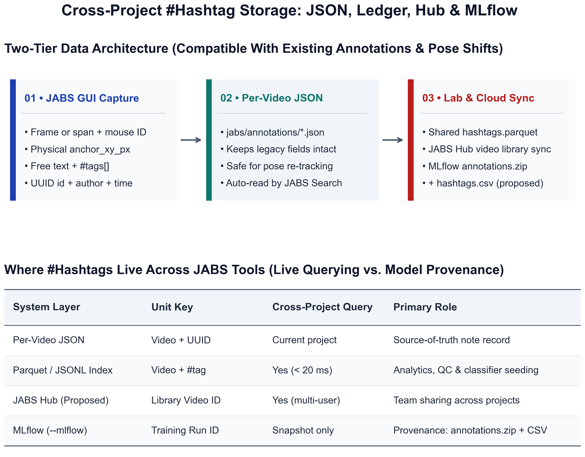

# Design Proposal / RFC: `#Hashtag` Video Comments & Cross-Project Notes

- **Status:** Draft / Request for Comments (`@gbeane`, `@bergsalex`)
- **Authors:** Vivek Kumar (with Antigravity)
- **Repository:** `jabs-behavior-classifier`
- **Scope:** Design proposal & UI mockups only (no code changes in this PR). Aligns with [JABS Hub-backed projects plan](jabs-hub-backed-projects-plan.md) and [`jabs.classifier.mlflow_logging`](../../../src/jabs/classifier/mlflow_logging.py).

---

## 1. Why We Need `#Hashtag` Video Comments

During labeling, active-learning triage (BALE), and large-cohort screening, biologists routinely spot important events that are **not** labels for the currently open classifier:

- *Cross-behavior sightings:* spotting `#lorr` (loss of righting reflex), `#wds` (wet-dog shake), or `#scratch` while labeling `Grooming` or `Jumping`.
- *Pose & video QC issues:* `#id_swap`, `#missing_keypoints`, `#cage_glare`, `#dark_frame`.
- *Exemplar curation:* flagging crisp `#exemplar` or `#boundary_ambiguous` bouts for teaching, methods figures, or multi-reviewer arbitration.
- *Exploratory discovery:* tagging unexpected phenotypes across animals and drug/strain arms *before* committing to training a full classifier.

### Current Foundation & Gaps in `TimelineAnnotations`

JABS already has an interval annotation system ([`timeline_annotations.py`](../../../src/jabs/project/timeline_annotations.py), [`annotation_edit_dialog.py`](../../../src/jabs/ui/dialogs/annotation_edit_dialog.py), [`annotation_overlay.py`](../../../src/jabs/ui/player_widget/overlays/annotation_overlay.py), and [`TimelineAnnotationSearchQuery`](../../../src/jabs/behavior_search/behavior_search_util.py)), which stores entries in `jabs/annotations/<video>.json` under `"annotations": [...]`.

However, five friction points keep users from using it for fast `#hashtag` commentary today:

1. **Modal multi-step entry:** Users must enter Select Frames mode first, click `New Timeline Annotation`, and fill out a full dialog — there is no 1-key quick bookmark/comment flow at a single frame.
2. **Single rigid tag (`MAX_TAG_LEN = 32`):** Each entry holds only one `[A-Za-z0-9_-]` tag string, so free-text observations with multiple hashtags (e.g., `"Hindlimb slip on wheel #ataxia #slip #exemplar"`) cannot be typed naturally or queried by individual tag.
3. **Locked scope/interval in Edit mode:** Changing a frame span or moving a note from video scope to an animal requires deleting and recreating the annotation.
4. **Trapped inside one JABS project:** Notes added on a video in Project A (`Grooming_Round3`) are invisible in Project B (`Jumping_Round2`) even when both projects point to the exact same `.mp4` / Hub library video.
5. **No cross-video / cross-project `#hashtag` browser:** There is no project-wide summary table, autocomplete vocabulary, kinematic sanity check, or classifier-seeding export.

---

## 2. Candidate GUI Workflows (Mockups)



### Option A — Instant `#` Quick-Comment Bar & `Notes [#]` Timeline Pins *(Speed-First)*

- **Entry (`#` shortcut):** Pressing `#` anywhere during playback or scrubbing auto-pauses the video and opens a slim floating bar directly under the canvas, pre-filled with **current video**, **active frame** (or active timeline span), and **currently selected mouse** (with a one-click toggle to `Whole Video`).
- **Live `#` Autocomplete:** Typing `#` suggests tags already used in the project/lab sorted by frequency, with zero modal popups. Pressing `Enter` saves and optionally resumes playback.
- **Timeline Pins (`Notes [#]`):** A slim track directly above the manual label bar shows point pins (`start == end`) and short span bars (`start < end`); hovering shows the comment and clicking jumps straight to the frame and selects that mouse.
- **Pros:** `< 2 s` capture latency, `0 px` permanent screen width overhead.
- **Cons:** Best paired with Option B or C when reviewing dozens of notes sequentially.

### Option B — Collapsible Right-Side `#Hashtag` & Comment Feed Drawer *(Review-First)*

- **Panel:** Toggleable right-hand drawer beside the video canvas showing `#tag` filter chips (`All (14)`, `#lorr (4)`, `#wds (5)`, …) and a chronological feed of comment cards.
- **Interaction:** Clicking any card jumps the player, highlights the tagged animal, and lets reviewers edit scope/text or append follow-up `#tags` inline; collapses cleanly when full labeling focus is needed.
- **Pros:** Natural multi-user review queue (e.g., team reviews `#check_label` or `#id_swap` notes top-to-bottom).
- **Cons:** Consumes horizontal space when expanded on smaller laptop screens.

### Option C — Cross-Project `#Hashtag` Explorer & Classifier Seeder *(Analytics-First)*

- **Entry:** Can live as a standalone **Tools → `#Hashtag` Explorer…** window (or as a 5th workflow tab in BALE alongside Audit / Predict / Sub-Types / Videos).
- **Capabilities:**
  - **Shared `#Hashtag` Leaderboard:** Aggregates tag counts, projects, and cages across local projects (`hashtags.parquet`) or JABS Hub.
  - **Kinematics Sanity Check:** Projects `#tagged` frames/bouts into JABS pose feature space so researchers can see if an exploratory tag like `#lorr` or `#scratch` forms a distinct kinematic cluster *before* investing in a new classifier.
  - **One-Click Actions:** `Send #tag to JABS Search`, `Export Clips / Parquet`, `Pose QC List`, or **Seed Starter JABS Project** directly from tagged clips.

### Recommended Phasing

1. **Phase 1 (High ROI, Small Diff):** Ship **Option A** (`#` quick-comment bar + single-frame `Notes [#]` timeline pins) + a multi-hashtag extension to JABS's existing `TimelineAnnotations` and `SearchBarWidget`, plus an optional toggleable **Option B** feed drawer.
2. **Phase 2 (Cross-Project Reuse & Seeding):** Add the shared `hashtags.parquet` ledger, Hub library-video linkage (per Section 4), and **Option C** analytics/seeding view.

---

## 3. Data Model & Cross-Project Reuse



### Tier 1 — Backward-Compatible Extension to `jabs/annotations/<video>.json`

To ensure zero breakage for existing JABS overlays, `BehaviorSearch`, and JABS Hub's JSON annotation contract ([`jabs-hub-backed-projects-plan.md`](jabs-hub-backed-projects-plan.md), Appendix A.1), each entry keeps existing `TimelineAnnotations` fields (`start`, `end`, `tag`, `color`, `identity`, `description`) and adds backward-compatible optional fields:

```json
{
  "id": "019360a4-8c2b-7f10-9a12-4d3e8b1f2041",
  "start": 742,
  "end": 742,
  "kind": "point",
  "identity": 1,
  "external_identity": 1234,
  "anchor_xy_px": [1842.5, 914.0],
  "text": "Slip on wheel #ataxia #slip #exemplar",
  "hashtags": ["ataxia", "slip", "exemplar"],
  "tag": "ataxia",
  "description": "Slip on wheel #ataxia #slip #exemplar",
  "color": "#0F766E",
  "author": "vkumar",
  "created_at": "2026-11-25T00:52:10Z",
  "origin_project": "Jumping_Round2_JABS_Project",
  "pose_sha256_prefix": "a84f91c2d01e"
}
```

Key design properties for cross-project reuse:

- **Point + Span Support:** `kind: "point"` uses `start == end` (fully valid under `TimelineAnnotations._frame_range_valid`, which enforces `start <= end`); `kind: "span"` uses `start < end`.
- **Multiple `#Hashtags` Without Breaking Single-Tag Readers:** `hashtags: list[str]` stores all normalized lowercase tags (`["ataxia", "slip", "exemplar"]`), while `tag` stores the primary display tag (`"ataxia"`) so older JABS versions continue rendering without crashing.
- **Survives Pose Re-Tracking Across Projects (`anchor_xy_px`):** Because track indices (`0, 1, 2`) can renumber if another project uses a newer pose file (`v4–v8` / unified `jabs.pose-file`), recording the mouse's physical `(x, y)` centroid in pixels at `start` (alongside `external_identity` when available) lets another project match the note to the same physical animal even when track IDs permute.
- **Idempotent Merging (`id` UUID):** Prevents duplicates when notes are synced between projects or exported to shared tables.

### Tier 2 — Cross-Project Analytical Index (`hashtags.parquet` + Ledger)

Per-video JSON files are ideal for editing, but parsing hundreds of JSONs across 10+ projects is too slow for cross-project cohort analysis. Writing/updating a lightweight flat table (`<project>/jabs/hashtags.parquet`, plus an optional user/lab ledger at `~/.jabs/hashtags_ledger.jsonl` or `/projects/kumar-lab/.../hashtags_ledger.parquet`) enables instant `< 20 ms` queries:

- Pull every `#lorr` or `#scratch` moment spotted across all lab projects to seed a new JABS classifier project.
- Join `#hashtag` counts directly against strain, drug, dose, and cage metadata in pandas/R before training any model.
- Harvest all `#id_swap` / `#missing_keypoints` frames across cohorts for pose-model QA.

---

## 4. JABS Hub & MLflow Integration

### JABS Hub *(Primary Multi-User Cross-Project Sync)*

Per [`jabs-hub-backed-projects-plan.md`](jabs-hub-backed-projects-plan.md), JABS Hub already centralizes a shared **Video Library** (`videos` table, many-to-many with `projects`) and plans to sync per-video `annotations` JSON documents with optimistic concurrency and attribution. Putting `#hashtag` notes inside `"annotations"` means Hub annotation sync handles them out of the box—with one key architectural question for `@gbeane` and `@bergsalex` below (project-scoped vs. library-video-scoped visibility).

### MLflow *(Model-Training Provenance Snapshot, NOT Live Query Store)*

- **Does it end up in MLflow?** **Yes as a frozen snapshot, No as the live cross-project database.**
- [`src/jabs/classifier/mlflow_logging.py`](../../../src/jabs/classifier/mlflow_logging.py) (`ANNOTATIONS_ARCHIVE_NAME = "annotations.zip"`) **already** archives `jabs/annotations/*.json` on every `jabs-cli cross-validation --mlflow` run, so per-video hashtags travel automatically with the training snapshot.
- In addition, `--mlflow` can attach a flat **`hashtags.csv`** artifact and **`n_hashtag_notes`** / tag-summary tags per run so anyone inspecting an MLflow run sees which `#hard_negative`, `#boundary_ambiguous`, or `#qc` notes existed at training time.
- Live cross-project discovery stays in `hashtags.parquet` / JABS Hub because users frequently drop hashtags on **unlabeled** videos or for **other behaviors** when no classifier is being trained.

---

## 5. Open Design Questions for Review (`@gbeane`, `@bergsalex`)

1. **Extend `TimelineAnnotations` vs. separate `"comments"` key?** Extending `"annotations"` keeps existing overlays, `TimelineAnnotationSearchQuery`, `AnnotationStore`, and the Hub annotation contract working seamlessly. Any concern with adding optional fields (`id`, `kind`, `hashtags`, `text`, `anchor_xy_px`, `author`, `created_at`, `origin_project`) to items in `"annotations"`, or would `jabs.io` schema/NWB export prefer a separate top-level `"hashtags"` array?
2. **Default keyboard shortcut & quick-entry UX:** Is **`#`** (auto-pause + floating bar below the player, `Enter` saves & resumes, `Esc` cancels) intuitive alongside existing labeling keys (`z`, `x`, `c`), or does anything conflict?
3. **Drawer vs. BALE / standalone Explorer:** Do you prefer **Option A + B** in the main JABS window first (keeping main UI self-contained), and should cross-project analytics (**Option C**) live inside BALE (`Tools → BALE…`) or as its own lightweight dialog?
4. **Hub Scope (Project vs. Shared Library Video):** In JABS Hub, should `#hashtag` comments default to **project-scoped** (like behavior labels), or should Hub support a **video-library-level** overlay/opt-in feed so a `#lorr` or `#id_swap` note tagged on a library video in Project A can surface when opening that same video in Project B?
5. **External / Physical Animal Anchoring:** For unified `jabs.pose-file` (ADR 0002), is storing `anchor_xy_px` (`[x, y]` at `start`) plus optional `external_identity` the right lightweight way to resolve animal identity across pose versions?
6. **MLflow Artifact:** Alongside `annotations.zip`, is attaching a small `hashtags.csv` summary artifact during `jabs-cli cross-validation --mlflow` worthwhile?
