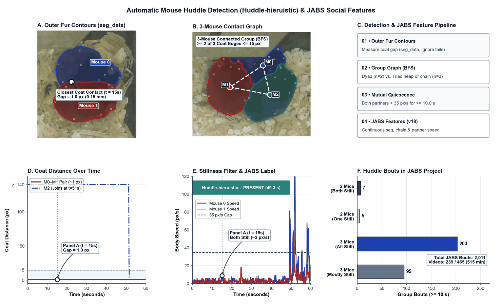
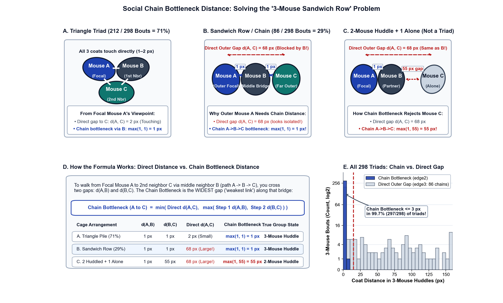
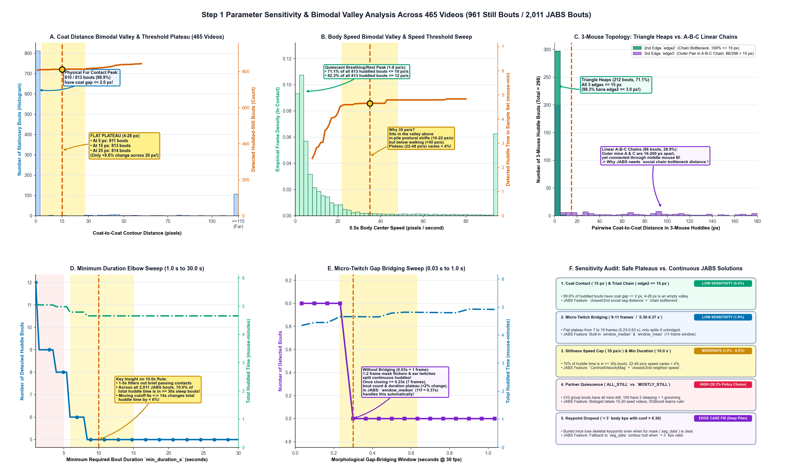

# Per-Frame Features

## Egocentric Animal Features

142 features from 12 animal keypoints

* point mask (boolean, 12 values)
* pairwise distances between all points (66 values)
* angles between a subset of connected points (11 values)
    * nose, base neck, right front paw
    * nose, base neck, left front paw
    * right front paw, base neck, center spine
    * left front paw, base neck, center spine
    * base neck, center spine, base tail
    * right rear paw, base tail, center spine
    * left rear paw, base tail, center spine
    * right rear paw, base tail, mid tail
    * left rear paw, base tail, mid tail
    * center spine, base tail, mid tail
    * base tail, mid tail, tip tail
* angular velocity (using base tail → base neck bearing)
* velocities (each velocity listed below consists of four features – the direction and magnitude components as well as the sine and cosine of the direction component)
    * centroid
    * 12 keypoints

## Social features (v3+ pose files)

32 features from social context (available when multi-animal tracking is present in v3+ pose files, with automatic segmentation-contour refinement when `seg_data` masks are present in v6+ pose files):

* **Nearest-neighbor & coat-contact distances (`closest_distances`, 5 values):**
    * `closest social distance`: Euclidean distance between the subject's skeletal body convex hull and the nearest cagemate's skeletal convex hull.
    * `second closest social distance`: Euclidean distance between the subject's skeletal convex hull and the second-nearest cagemate's skeletal convex hull (distinguishes 2-animal pairs from 3-animal groups).
    * `closest social segmentation distance`: Minimum fur-to-fur boundary distance between the subject's outer segmentation mask contour (`seg_data` in v6+ pose files) and the nearest cagemate's segmentation contour (falls back to `closest social distance` when segmentation masks are absent). Because skeletal keypoints sit *inside* the body while huddling animals press their outer soft flanks together, measuring the outer coat contour captures physical fur contact directly.
    * `second closest social segmentation distance`: Minimum outer segmentation contour distance to the second-nearest cagemate.
    * `closest social distance body units`: Dimensionless, camera-height-invariant coat distance normalized by the subject's characteristic body size ($\text{closest segmentation distance} / \sqrt{\text{Hull Area}}$), expressed in units of animal body widths so classifiers generalize across arena zoom levels and juvenile vs. adult body sizes without requiring `cm_per_pixel` calibration.
* **Multi-animal huddling topology & partner quiescence (`huddle_features`, 5 values):**
    * `social contact count`: Number of other animals currently in physical body contact with the subject (`0`, `1`, `2`, ...).
    * `social connected group size`: Total number of animals in the subject's connected contact cluster (`1` = isolated, `2` = dyadic pair, `3` = 3-animal group), computed via breadth-first search (BFS) so both triangular piles and side-by-side linear chains (`A–B–C`, where outer mice `A` and `C` touch opposite flanks of middle mouse `B`) are recognized as a 3-animal group.
    * `social chain bottleneck distance`: Threshold-free continuous single-linkage (minimax) coat distance connecting the subject and its two nearest cagemates into a 3-animal cluster: $\max(d_1, \min(d_2, d_{12}))$. Across 298 three-mouse huddles (`71.1%` triangular heaps + `28.9%` linear `A–B–C` chains), `99.7%` have a chain bottleneck distance $\le 3\text{ px}$, allowing tree classifiers (`XGBoost` / `RandomForest`) to learn 3-animal huddling without any hard-coded pixel threshold.
    * `closest neighbor speed`: Centroid speed of the nearest cagemate, allowing classifiers to separate **mutual quiescence** (both partners sleeping/resting in a huddle) from **unilateral contact** (an active cagemate walking past or sniffing a stationary mouse).
    * `second closest neighbor speed`: Centroid speed of the second-nearest cagemate, allowing classifiers to distinguish 3-animal huddles where all 3 animals are asleep from piles where 2 animals sleep while the 3rd grooms or shifts posture.
* **Field-of-view (FoV) social metrics (4 values):**
    * `closest social distance in FoV`: Distance to the nearest cagemate within the subject's $240^\circ$ visual field of view ($\pm 120^\circ$ from the `BASE_NECK` $\to$ `NOSE` heading vector).
    * `angle of closest social distance in FoV` (plus `sine` and `cosine` components).
* **Pairwise keypoint social distances (18 values):**
    * `pairwise_social_distances` (9 values): All $3 \times 3$ pairwise distances between (`NOSE`, `BASE_NECK`, `BASE_TAIL`) of the subject and the closest cagemate.
    * `pairwise_social_fov_distances` (9 values): All $3 \times 3$ pairwise distances between (`NOSE`, `BASE_NECK`, `BASE_TAIL`) of the subject and the closest cagemate inside the field of view.

> **Occlusion Resilience During Deep Huddling:**
> 1. **Nose Occlusion Decoupling:** Nearest-neighbor identity and body-hull distances depend only on valid body hulls (`>= 3` body keypoints), while `NOSE` and `BASE_NECK` are required only for directional Field-of-View (`FoV`) features. When a sleeping mouse tucks its nose under a cagemate, social distance and huddling features remain valid instead of dropping to `NaN`.
> 2. **Segmentation-Contour Hull Fallback (v6+):** If a mouse buried at the bottom of a 3-animal pile has fewer than 3 confident skeletal keypoints (`confidence > 0.30`), JABS automatically constructs a fallback convex hull from its visible segmentation contour (`seg_data`) so social features do not drop out.

## Static object features (v5 pose files)

### Arena Corners

9 features from arena corners

* distance to corner using the convex hull center
* distance to nearest wall using the convex hull center
* distance to arena center using the convex hull center
* bearing to corner using angle of the base neck - nose vector
  * bearing to corner sine
  * bearing to corner cosine
* bearing to arena center using angle of the base neck - nose vector
  * bearing to arena center sine
  * bearing to arena center cosine

### Water Spout (Lixit)

15 feature from lixit

* distance from each keypoint to nearest lixit (12 values)
* bearing to lixit
* bearing to lixit sine
* bearing to lixit cosine

When more than one lixit is present, the nearest lixit is selected per frame using the distance
from the mouse centroid to each lixit tip. Using the centroid rather than a single keypoint (such
as the nose) keeps this selection stable when individual keypoints are missing from the pose.

### Water Spout (Lixit) extended (experimental)

Optionally supports extended set of lixit features if the lixit is labeled with three keypoints (tip, left side, right side).

2 additional extended features: 

* cosine of angle between the vector going from the tip of the lixit to the middle of the two sides
    and the vector going from the mouse's centroid to the nose
* cosine of angle between the vector going from the tip of the lixit to the middle of the two sides
    and the vector going from the mouse's base tail to the centroid

### Food Hopper

10 features from food hopper

* signed distance from keypoint to food hopper border (positive = inside, negative = outside)
    * nose
    * left ear
    * right ear
    * base neck
    * left front paw
    * right front paw
    * center spine
    * left rear paw
    * right rear paw
    * base tail

## Segmentation (v6 pose files)

32 features from segmentation data

* 15 translation-invariant image moments
* 7 hu image moments
* 10 shape descriptors

# Window Features

Window features describe how a specific per-frame feature may be changing over time. We use a centered window around the frame of interest. These calculated features are added to the total feature vector. Window features calculated are different whether or not the per-frame feature is non-circular or circular.

## Non circular measurements

### Standard Statistical Summaries

* Mean
* Median
* Standard Deviation
* Skew
* Kurtosis
* Maximum
* Minimum

### Signal Processing Summaries

Since signal processing features use the same window size as the standard statistics, some frequency bands may not contain any observable values. When this occurs, the feature is padded with zeros and is ignored by the classifier. We do not zero-pad the input feature vector to a specific size so that we can observe frequencies.

* Power Spectral Density Sum
* Power Spectral Density Maximum Power
* Power Spectral Density Minimum Power
* Power Spectral Density Mean Power
* Power Spectral Density Mean Power in a Band
    * 0.1Hz to 1Hz
    * 1Hz to 3Hz
    * 3Hz to 5Hz
    * 5Hz to 8Hz
    * 8Hz to 15Hz
* Power Spectral Density Standard Deviation
* Power Spectral Density Skew
* Power Spectral Density Kurtosis
* Power Spectral Density Median
* Frequency with Maximum Power

## Circular measurements

These features contain ciruclar measurements and need to be treated differently. As such, different window features are calculated for them.

### Statistical Summaries

* Circular Standard Deviation
* Circular Mean

#### Circular Feature List

* Angles
* Bearings

# Methods of handling Missing or Infinite Data

Features only propagate NaN (not a number) values forward to indicated missing or invalid data. Infinity and negative infinity values are converted to NaNs. Different parts of the software will handle NaN values differently, described below.

## Classifiers

### XGBoost Classifier

XGBoost classifiers support handling missing data.

### Random Forest and Gradient Boosting Classifiers

These classifiers do not support missing data. Feature vectors are padded with zeros where missing data is found.

## Per-Frame Features

When the input prediction required to calculate the feature is missing, the feature value for that frame stores a NaN value.

## Window Features

When a feature in a window is not present, the missing value is masked out for the window operation. For example, a mean operation of window size 5 (11 values) with 1 missing value will simply calculate the mean of 10 values.

This may have adverse effects for skew and kurtosis estimates, as the window may shift based on where the data is missing, providing a wrong estimate for the central frame.

## Signal Features

Per-frame features fill missing values with zeros before passing into the FFT.

# Extra Features calculated, but not used in a classifier

These features are calculated and stored in cached feature files outside the `features` folder. These features are excluded from being available features during classifier training. Features present here are either allocentric or otherwise represent information that may be useful when postprocessing behavior calls. For example, if you train a chase classifier, one may be interested in inspecting which other mouse the individual is chasing. Inspecting the closest mouse in field of view during each chase bout would provide that information.

## Closest Objects

For calculating distances and bearings to nearby items, sometimes there are multiple items to choose from. For the following objects, we identify which object is closest by using the current mouses convex hull centroid and the other object.

* Closest mouse index
* Closest mouse index in field of view
* Closest arena corner index
* Closest water spout (lixit) index

## Wall Distances

When calculating the nearest arena wall distance, we also calculate the perpendicular distance from the animal centroid to every wall.

* Perpendicular distance to all 4 walls
* Average wall length
